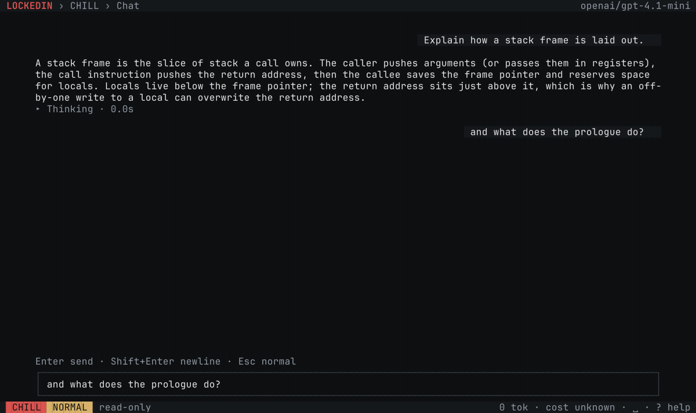
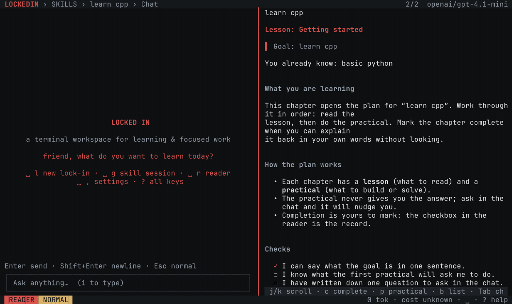
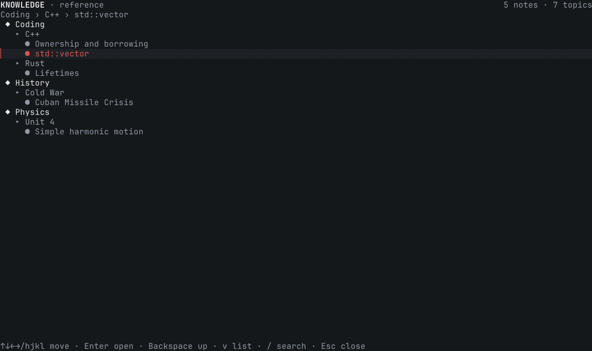
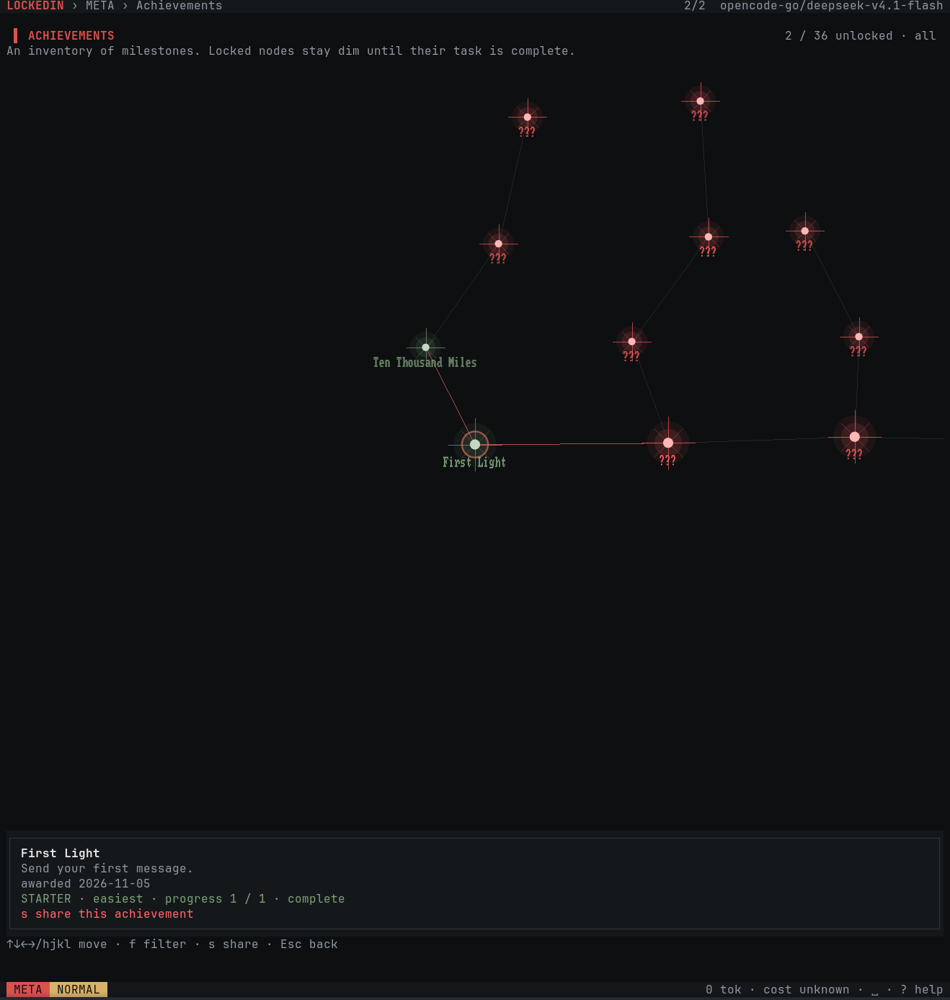
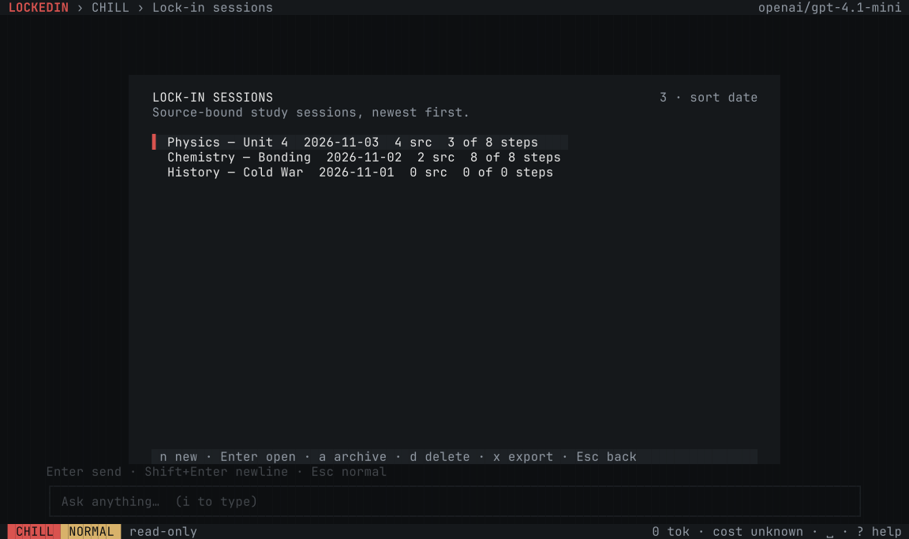

# LockedIn-Tui

[](https://github.com/Jacob-Chamney/LockedIn-Tui/actions/workflows/ci.yml)
[](LICENSE)

A keyboard-first terminal workspace for learning and focused work. It runs
inside your terminal, uses the terminal's own GPU rendering, and keeps your
workspace on your machine.

[Documentation](https://github.com/Jacob-Chamney/LockedIn-Tui/wiki) · [Releases](https://github.com/Jacob-Chamney/LockedIn-Tui/releases) · [Changelog](CHANGELOG.md)

## Features

### Chat and lock-in sessions



Chat with your configured model, with Markdown, syntax highlighting and
per-conversation usage. A lock-in session binds the conversation to a goal and
its sources so the work stays on the material you chose.

### Skill sessions and reader



Turn a goal into chapters, lessons and practical work. The reader tracks
completion, and generated study material is built from the sources you added.

### Knowledge reference



Keep notes, topics and references in one navigable tree, searchable from the
keyboard and available beside your sessions.

### Achievements

<p align="center"></p>

A map of milestones that unlocks as you use the workspace, with a detail panel
and sharing for completed achievements.

### Lock-in sessions



Find, archive, export or delete lock-in sessions from one keyboard-driven list.

Also included: work projects and agents, archive and source indexing, usage
budgets, themes, MCP plugins, and terminal image support where the terminal
allows it.

## Install

> **The first dated release (`2026.11.12`) is being prepared.** Until it is
> published, `latest` still points at the previous 1.x release. Use the source
> instructions below to run this tree.

Install the latest release:

```sh
curl -fsSL https://github.com/Jacob-Chamney/LockedIn-Tui/releases/latest/download/install.sh | sh
```

The installer detects the platform, verifies the artifact against the release
`SHA256SUMS`, and installs to `~/.local/bin/lockedin`. It never uses `sudo` and
never edits your shell profile.

Supported platforms: Linux x64/arm64 (glibc and musl), macOS arm64/x64 and
Windows x64.

### Manual install

Download the asset for your platform, mark it executable and run it:

```sh
chmod +x lockedin-2026.11.12-bun-linux-x64
./lockedin-2026.11.12-bun-linux-x64 --workspace ~/LockedIn
```

## Run from source

Requirements: [Bun](https://bun.sh) **1.4.4** and Git.

```sh
bun install --frozen-lockfile
bun run start
```

The first run creates a workspace at `~/LockedIn`. Use `--workspace <path>` or
`LOCKEDIN_WORKSPACE` to choose another folder.

```sh
bun run start --workspace ~/Learning
```

## Development

`bun run check` is the full gate: boundary checks, typecheck, the test suite and
the startup budget.

```sh
bun run check
```

Layout:

```
src/        application code
tests/      unit, contract, integration, invariant, UI and end-to-end tests
scripts/    build, check and performance tooling
assets/     screenshots used by the README
licenses/   third-party licence texts
```

## Security

Report vulnerabilities privately through the repository's Security tab. See
[SECURITY.md](SECURITY.md). Do not open a public issue for a security problem.

## Contributing

Contributions are accepted under the Developer Certificate of Origin. See
[CONTRIBUTING.md](CONTRIBUTING.md) and sign commits with `git commit -s`.

## Licence

AGPL-3.0-only. See [LICENSE](LICENSE) and [TRADEMARK.md](TRADEMARK.md).
